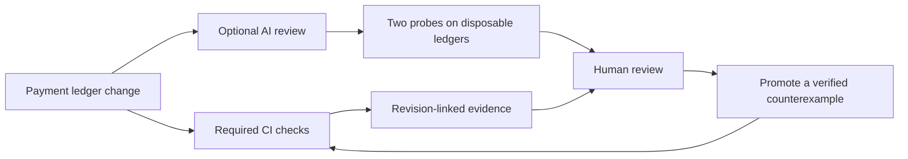

# Payment Change Review implementation plan

## One business rule, from change to evidence

A payment service must preserve the first amount when it receives the same delivery again. Event IDs may be reused across accounts, so the ledger uses `(account_id, event_id)` as its key. The implementation uses integer minor units, stores bookings on disk, and wraps lookup plus insertion in one SQLite write transaction. A replay with a changed amount keeps the original entry and returns `amount_matches=False` for a caller to investigate.

For the demo, both the deliberately faulty lookup and current code invoke the same booking implementation. Only the lookup differs. The CI check runs from the actual checkout, exits nonzero for the seeded regression, and uploads a structured report. The agent receives a source excerpt and a narrow way to execute typed synthetic inputs. It has no shell or deployment tools. A human explicitly promotes a cited failing probe after confirming that the current ledger passes it. The saved case includes the expected amount, provenance and a digest of the source trace. Future CI runs need no model to execute the promoted test.

## Feasibility and boundaries

| Concern | Implemented and verified locally | What a team pilot would validate |
| --- | --- | --- |
| Correctness | Persistence across reopen, cross-account identity, changed replays, input validation, write rollback and concurrent duplicate handling. | Confirm idempotency scope with the payment and reconciliation owners. Agree how to escalate conflicting amounts and which events can be replayed. |
| Integration | A CLI gate, a GitHub Actions definition and downloadable JSON evidence. The good and seeded bad cases exercise the same code path. | Run the action in the team's repository, set the required check and the owner for rule assertions, and record review outcomes. |
| Cost | CI runs without API requests. Optional agent reviews are capped at seven model actions and two extra probes per case. API runs record reported token counts. | Measure added reviewer time and tokens per confirmed finding. Use the agent for changed or unfamiliar rules where fixed cases offer limited coverage. |
| Resilience | Each probe gets a disposable database. Fixed checks run with no model credential. A green result is a handoff for human review. | Trial provider timeout and degraded-mode handling in the review pipeline. Decide which changes require a domain reviewer before release. |
| Privacy and evidence | Local runs use synthetic events. The shared HTML embeds only the recorded synthetic evidence. The CI definition grants read-only repository access and retains its evidence artifact for seven days. | Approve the inference provider and eligible source excerpts. Align reporting access and retention with the team's existing review process. |

## Scalability and sustainability

The [local run](evidence/load.json) sent **800 deliveries through eight workers**, persisted **200 unique payments**, suppressed **600 replays**, and matched all eight account totals. Each account reused the same set of event IDs. The report records local throughput and p95 per delivery for Python 3.12.7 and SQLite on Windows. Rerun `python payment_load.py --workers 1` and `python payment_load.py --workers 8` on comparable hardware to investigate lock contention. The recorded run has no network, replication, reconciliation job, or production traffic mix.

SQLite serializes writes in a single database. Start with one disposable database per CI task, so independent changes can be checked in parallel. When piloting the review service at team scale, bound concurrent agent jobs and deduplicate repeated work using the revision, rule version and model version. Keep the booking contract and tests if the payment workload moves to a managed transactional database. Benchmark contention and inspect uniqueness, retry recovery and reconciliation behavior against that database before deciding capacity. [SQLite transaction behavior](https://www.sqlite.org/lang_transaction.html)

Promoted tests capture team knowledge in versioned, provider-independent data. Assign an engineering owner to prune duplicate checks when the rule changes, with a payment domain owner approving the expected outcome. There is no always-on demo server and no model dependency for ordinary CI. Track tests added, duplicate findings, token use and review minutes before claiming savings. Run lightweight deterministic tests per change and reserve model evaluations and larger concurrency runs for decisions that need them.

## Pilot exit criteria

Start with payment retry and refund changes approved for a synthetic staging environment. The first phase runs the CI check in reporting mode and verifies evidence, rollback and human handoff. The second phase gives reviewers agent evidence on a randomized subset of comparable changes. Use independent adjudication to score material defects confirmed, misses, unnecessary holds and reviewer time. Ask reviewers to apply a rule to a new example one week later. Agree severity and time thresholds before assignment. Expand the workflow only if the reviewed evidence shows value within those thresholds. [Research protocol](research-plan.md) · [Stakeholder questions](research-brief.md)
